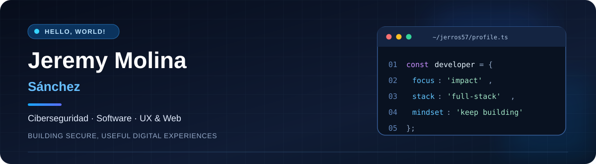

  

   

  **Tecnólogo Superior en Ciberseguridad · Estudiante de Ingeniería en Sistemas Inteligentes**

  <em>Diseño y desarrollo soluciones digitales donde la seguridad, la experiencia de usuario y la tecnología trabajan juntas.</em>

    

  
  
  
  

---

### 👨‍💻 Sobre mí

¡Hola! Soy **Jeremy Molina Sánchez**, desarrollador de soluciones tecnológicas desde **Guayaquil, Ecuador**. Mi trayectoria conecta la **ciberseguridad, el soporte e infraestructura TI, las bases de datos y la creación de productos digitales**.

Me interesa construir software útil y accesible, con bases técnicas sólidas y atención especial al diseño. He trabajado en soporte y seguridad de equipos corporativos, gestión de información y sistemas administrativos; hoy aplico esa experiencia a proyectos web, aplicaciones multiplataforma y herramientas de software libre.

- 🔐 **Seguridad:** gestión de vulnerabilidades, hardening, controles de acceso e integridad de datos con SHA-256.
- 🛠️ **Ingeniería:** Flutter/Dart, PHP, JavaScript, HTML/CSS, SQL y entornos de desarrollo.
- 🎨 **Producto y UX:** interfaces accesibles, responsive y centradas en las personas.
- 🎓 **Formación:** Tecnólogo Superior en Ciberseguridad (Instituto Superior Tecnológico Argos); Ingeniería en Sistemas Inteligentes en curso (ECOTEC).

### 🚀 Proyectos destacados

<table>
<tr><td width="50%" valign="top">

#### 🌐 [herUX](https://github.com/jerros57/herux_web_project)

**Comunidad de Mujeres en UX**

Experiencia web para dar visibilidad al talento femenino en UX, facilitar el acceso a actividades y construir comunidad.

`HTML` · `CSS` · `JavaScript` · `Responsive`

[Visitar sitio](https://heruxec.com/inicio) · [Repositorio](https://github.com/jerros57/herux_web_project)

</td><td width="50%" valign="top">

#### 🧩 [LandiCy](https://github.com/jerros57/landiCy)

**Editor y constructor web libre**

Herramienta para crear, editar y administrar sitios web mediante una experiencia visual, con tecnologías web y arquitectura PHP/MySQL.

`PHP` · `MySQL` · `HTML/CSS/JS` · `AGPL-3.0-or-later`

[Repositorio](https://github.com/jerros57/landiCy)

</td></tr>
<tr><td width="50%" valign="top">

#### 📱 Multicy

**Aplicación de redes comerciales**

Producto multiplataforma en desarrollo para líderes y clientes, con gestión de aportaciones, catálogos, perfiles y red de usuarios.

`Flutter` · `Dart` · `Firebase` · `UX móvil`

*Proyecto en desarrollo · Código no publicado aquí.*

</td><td width="50%" valign="top">

#### 🏢 EmpriCy

**Gestión empresarial integral**

Sistema en desarrollo orientado a procesos administrativos y empresariales, con una arquitectura de servicios y autenticación.

`Flutter` · `Dart` · `Serverpod` · `PostgreSQL` · `Docker`

*Proyecto en desarrollo · Código no publicado aquí.*

</td></tr>
<tr><td width="50%" valign="top">

#### 📦 Inventicy

**Inventario multiplataforma**

Aplicación académica para gestionar y consultar productos, con vistas de catálogo y detalle en Android.

`Flutter` · `Dart` · `Android`

*Proyecto académico.*

</td><td width="50%" valign="top">

#### 🧮 [Cotizador Herbalife](https://github.com/jerros57/CotizadorHerbalife)

**Herramienta de cotización interactiva**

Experiencia web adaptable para realizar cotizaciones de forma práctica.

`JavaScript` · `HTML` · `CSS`

[Probar demo](https://jerros57.github.io/CotizadorHerbalife/www/) · [Repositorio](https://github.com/jerros57/CotizadorHerbalife)

</td></tr>
</table>

### ⚙️ Tecnologías con las que trabajo

### 🧭 Mi enfoque

> **Construir con propósito.** Pensar primero en las personas, cuidar la seguridad desde el diseño y transformar problemas cotidianos en herramientas que realmente sirvan.

### 📊 Mi actividad en GitHub

  

🌎 English · About me

I'm **Jeremy Molina Sánchez**, a cybersecurity technologist and Intelligent Systems Engineering student based in Guayaquil, Ecuador. I build practical digital products that combine **security, software engineering, and user-centered design**. My projects span web development, open-source tooling, mobile applications, and business software.

---

  Hecho con propósito, código y atención a los detalles · © 2026 Jeremy Molina Sánchez

